# Monterey Canyon bathymetry in QGIS

A step by step guide to contour polygons and a layered paper map

Prepared for Teo Espero • 27 October 2026

This project adapts a tutorial credited by the author to Ariel Dome. It uses Monterey Canyon as the study area and GEBCO bathymetry as the terrain source. The goal is a circular, magenta and white map whose contour bands appear to have thickness through directional inner shadows.

The final result is a styled two dimensional map. The shadows suggest relief; they do not create an extruded three dimensional terrain model. Follow the numbered workflow first, then use the troubleshooting section if the result differs.

The screenshots document the actual working session. Some show intermediate settings that were later replaced. Captions identify these stages. The tutorial video was not transcribed or independently reproduced; the steps here describe this project’s workflow.

Tutorial reference: https://www.youtube.com/live/VQ6Ee2jETuo

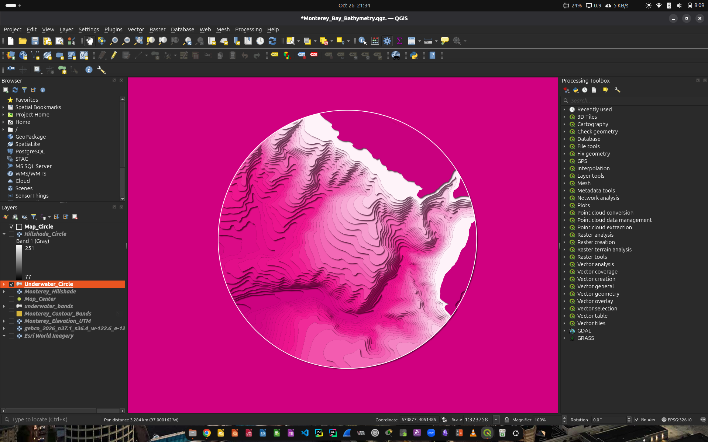

Final working map after the shadow adjustments. The visible color direction remains white on the shallow shelf and magenta in deeper areas.

# 1 Prepare the project

1. Open QGIS and create a new project. Save it as Monterey_Bay_Bathymetry.qgz in a dedicated project folder.

2. Create data, outputs, and exports subfolders. Keep the downloaded raster in data and generated layers in outputs.

3. Open Processing > Toolbox. If it is hidden, enable it from the Processing menu.

4. Set the project CRS to WGS 84 / UTM zone 10N, EPSG:32610, using the CRS button at the lower right.

5. Use GeoPackage for vector outputs and GeoTIFF for raster outputs. Save outputs to disk rather than leaving them as temporary layers.

QGIS dialog labels can vary by version. Search the Processing Toolbox for the algorithm name if a menu location differs. The workflows use GDAL raster tools and QGIS vector tools.

Expected outputs: Monterey_Elevation_UTM.tif, Monterey_Contour_Bands.gpkg, Monterey_Underwater_Bands.gpkg, Map_Center.gpkg, Map_Circle.gpkg, and Underwater_Circle.gpkg. The hillshade files are optional and are turned off in the final paper style.

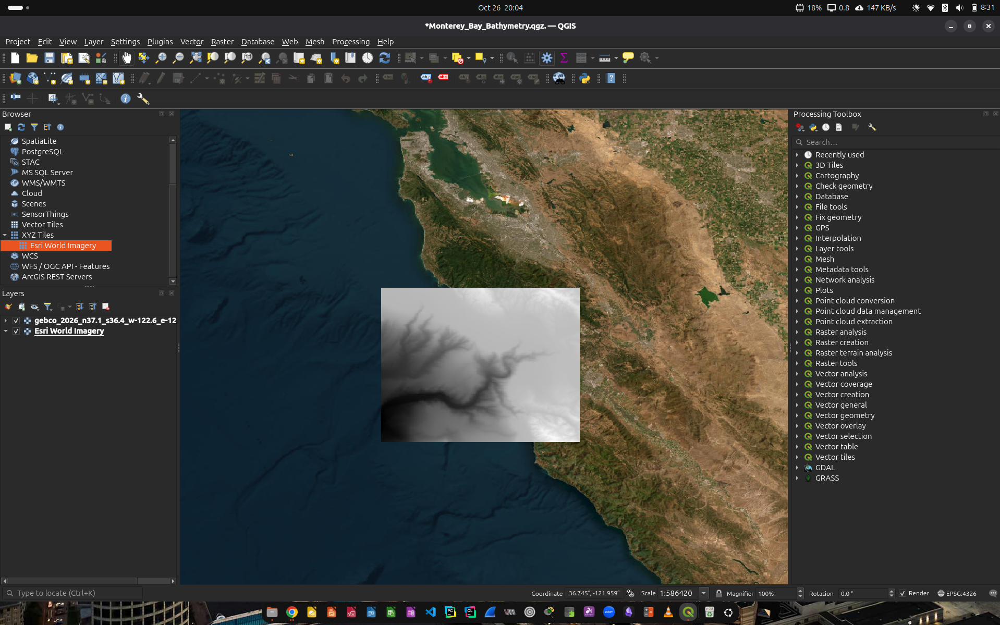

Initial raster loaded in QGIS. A basemap supplies geographic context but is not needed for the final artwork.

# 2 Download the bathymetry

1. Visit https://download.gebco.net/ and select the GEBCO 2026 Global grid used in this project.

2. Choose a user defined area and enter the rectangle below in geographic longitude and latitude.

West: -122.6    East: -121.7    South: 36.4    North: 37.1

3. Select GeoTIFF data for the elevation grid. Download the numeric data, not a rendered image and not the Type Identifier or TID grid.

4. Download the subset, extract the ZIP archive, and keep the .tif file and accompanying metadata together in data.

5. Drag the .tif into QGIS. The source name may include gebco_2026_n37.1_s36.4_w-122.6_e-121.7. Source coordinates are geographic, normally EPSG:4326; check Layer Properties > Information.

These coordinates define a convenient working rectangle. They were selected approximately to include the canyon and surrounding terrain; they are not an official Monterey Bay boundary, a calculated canyon extent, or a measured buffer. Longitude is negative west of Greenwich. Latitude is positive north of the equator.

GEBCO elevations are in metres. Underwater elevations are negative. The 15 arcsecond grid supports a regional illustration; it does not resolve every small seafloor feature. Reprojection to 400 metre cells does not add source detail.

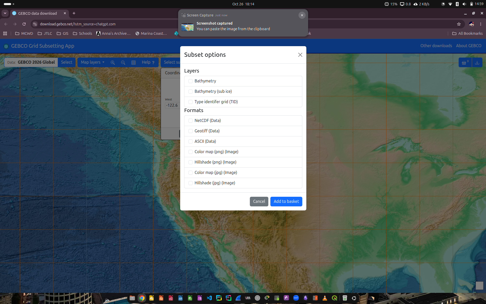

Download options during the session. Select the numeric elevation GeoTIFF.

# 3 Reproject the elevation raster

1. Search the Processing Toolbox for Warp (reproject), under GDAL > Raster projections.

2. Input layer: the downloaded GEBCO elevation GeoTIFF. Use its detected source CRS; do not assign UTM to geographic source coordinates.

3. Target CRS: EPSG:32610, WGS 84 / UTM zone 10N.

4. Resampling method: Bilinear. Target resolution: 400 metres. Output data type: Float32.

5. Preserve the source NoData handling; do not set zero as NoData because zero is a valid sea level elevation.

6. Save as outputs/Monterey_Elevation_UTM.tif and run. Confirm the new layer loads and its CRS is EPSG:32610.

The projected CRS makes later buffer distances and raster cell sizes use metres. Merely changing the project CRS changes display coordinates, while Warp writes a new raster grid in the target CRS.

Check the output folder before running. During the session, an output was saved under an unrelated project folder. Move or re-export it into this project and repair the layer path if necessary.

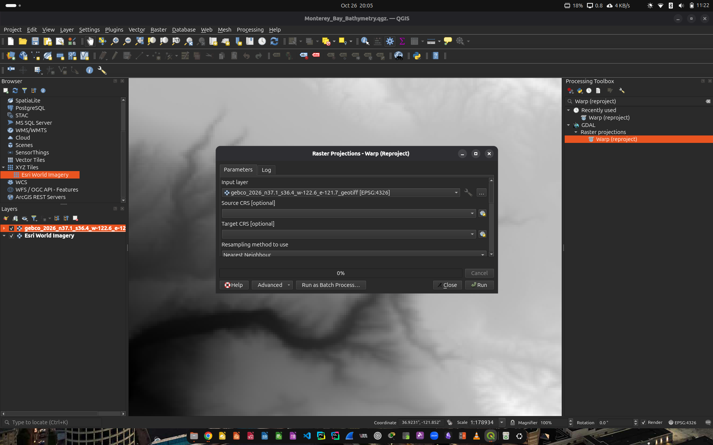

Raster reprojection setup during the working session.

# 4 Generate contour polygons

1. Search for Contour Polygons in the Processing Toolbox. Choose the GDAL tool, not the contour line tool.

2. Input: Monterey_Elevation_UTM. Band: 1. Interval between contour levels: 100 metres. Offset: 0.

3. Set the minimum elevation attribute name to ELEV_MIN and the maximum elevation attribute name to ELEV_MAX.

4. Save as outputs/Monterey_Contour_Bands.gpkg and run.

5. Open the attribute table and verify both elevation fields are present. Each polygon represents a band between two contour elevations.

6. Right click the layer > Filter and enter: "ELEV_MAX" <= 0

7. Export the filtered layer with Export > Save Features As. Use GeoPackage, EPSG:32610, file Monterey_Underwater_Bands.gpkg, and layer name underwater_bands.

8. Add the exported layer and turn off the original contour layer.

The filter retains underwater bands whose upper elevation is at or below sea level. The original elevation raster should keep its negative values. Do not multiply the entire raster by -1 just to set map colors.

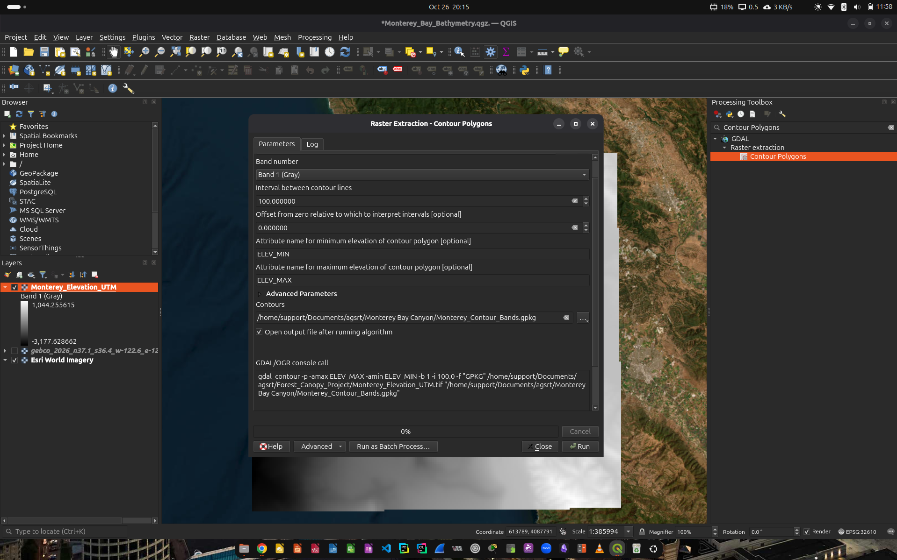

Contour polygon processing during the session.

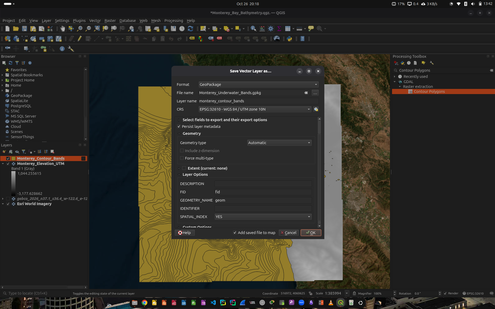

Exporting the underwater subset to a permanent vector layer.

# 5 Color the depth bands

1. Double click underwater_bands and open Symbology. Choose Graduated.

2. In Value, use the expression: -"ELEV_MAX"

3. Choose Equal Interval and 32 classes, then click Classify.

4. Click the Symbol preview. Select Simple Fill, retain a solid fill, and set Stroke style to No Pen. Confirm the change.

5. Choose a color ramp. The first blue version used pale blue through dark blue. The final artistic version uses magenta and white.

A band with ELEV_MIN = -1100 and ELEV_MAX = -1000 gets a styling value of 1000 metres. This is the depth of the band’s shallower boundary, not a measured mean depth.

The contour interval controls polygon geometry. The number of graduated classes only controls color assignment. Thirty two color classes do not create thirty two new contours, and equal interval color breaks do not need to fall exactly at 100 metre contour levels.

For a simple ramp, use two endpoints: magenta #C9007F and white #FFFFFF. Remove intermediate stops that cause the ramp to return to magenta. The ramp can later be reversed without changing the elevation data.

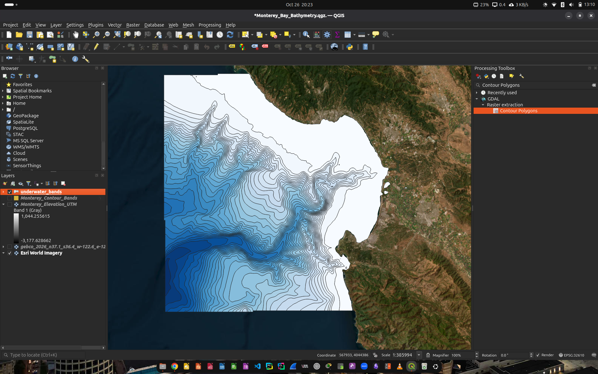

The earlier blue depth map. This was an intermediate color scheme.

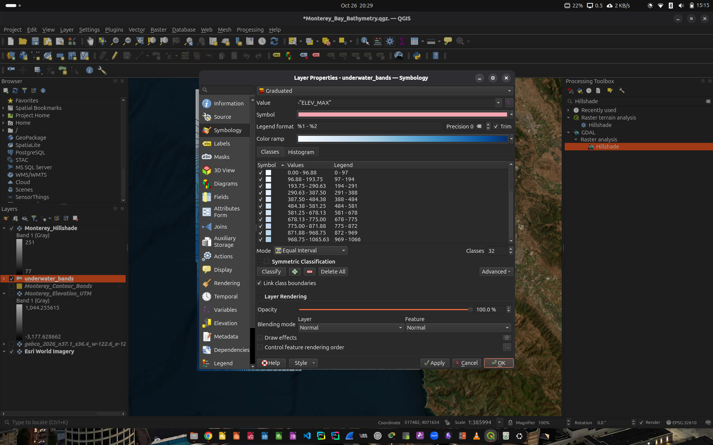

Graduated renderer and class settings during development.

# 6 Optional hillshade experiment

1. Search the toolbox for GDAL Hillshade.

2. Input: Monterey_Elevation_UTM, band 1. Use Z factor 1, scale 1, azimuth 315 degrees, and altitude 45 degrees.

3. Save as outputs/Monterey_Hillshade.tif and run.

4. Place the hillshade above the colored polygons. Try Multiply blending at about 30 percent layer opacity.

This was useful for the early blue bathymetry map. For the final magenta paper effect, turn the hillshade off. Combining a gray hillshade with strong polygon shadows can mute the colors and complicate the relief.

The hillshade uses the elevation surface and a simulated light direction. The polygon shadow effect is a separate graphic treatment. Its direction value is not an instruction to regenerate the hillshade.

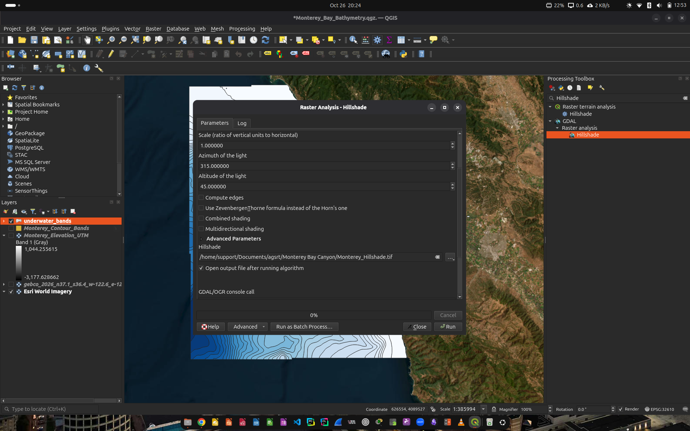

Hillshade processing during the initial blue map workflow.

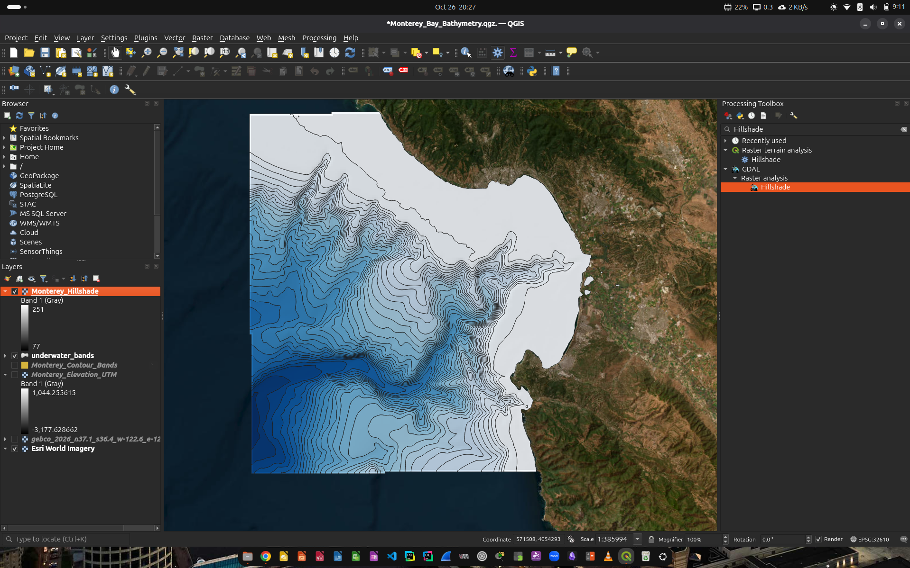

The early map with terrain shading before circular clipping.

# 7 Create the circular frame

1. Create a GeoPackage point layer named Map_Center using EPSG:32610. Add one point near the area you want to frame. Save edits and stop editing.

2. Search for Buffer under Vector geometry. Input: Map_Center. Distance: 30000 metres. Segments: 100. Use round joins and ends where offered.

3. Save as outputs/Map_Circle.gpkg and run. This is a 30 kilometre radius circle, approximately 60 kilometres across.

4. Style Map_Circle with Fill style No Brush and a white outline about 0.3 mm wide. Place it at the top of the layer list.

The center point was chosen visually for composition. Its exact coordinates were not recorded reliably in this guide. A new click will produce a different frame; inspect the result before clipping. To reproduce a chosen center exactly, use Identify Features or the attribute table geometry tools to record its coordinates in EPSG:32610.

The circle is an artistic frame, not a jurisdictional or scientific study boundary. Reposition it if the shoreline or canyon section you want falls outside the circle.

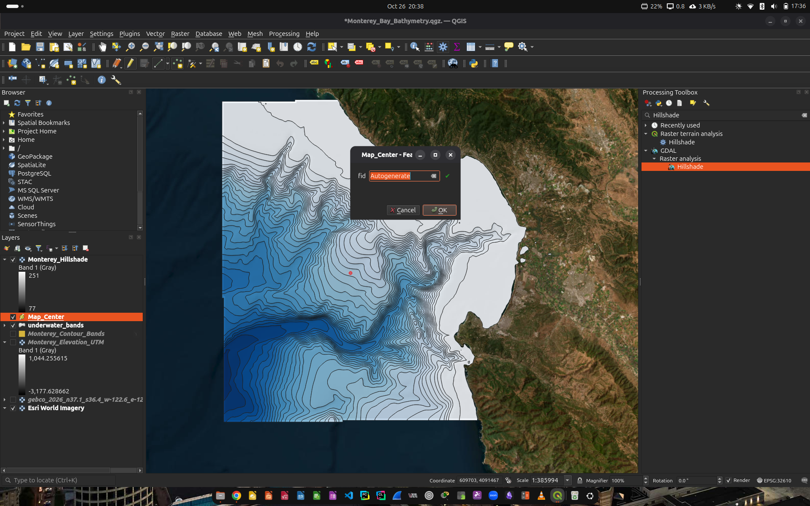

Placing the center point used for the circular composition.

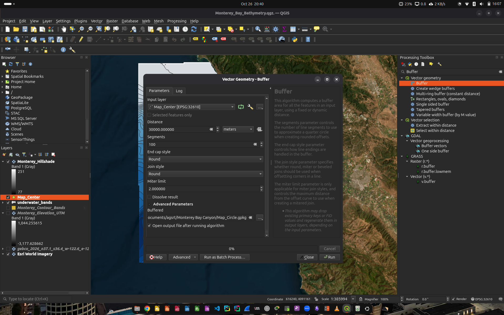

Buffer settings used to build the circular frame.

# 8 Clip the map to the circle

1. Search for Clip under Vector overlay. Input: underwater_bands. Overlay: Map_Circle.

2. Save as outputs/Underwater_Circle.gpkg and run.

3. Copy the underwater_bands style using right click > Styles > Copy Style. Paste the style onto Underwater_Circle. Turn off underwater_bands.

4. If you want to keep the optional hillshade version, run GDAL Clip raster by mask layer. Input: Monterey_Hillshade. Mask: Map_Circle. Crop to the mask extent, keep source resolution, and create an alpha band.

5. Save as outputs/Hillshade_Circle.tif. Place it above Underwater_Circle and below Map_Circle. Turn it off for the final paper map.

Final visible order: Map_Circle, then Underwater_Circle. The hillshade, original raster, original contour layers, center point, and basemap remain off.

Clipping the vector polygons requires Vector overlay > Clip. GDAL Clip raster by mask layer is for the raster hillshade. Choosing the wrong tool produces an incompatible input list.

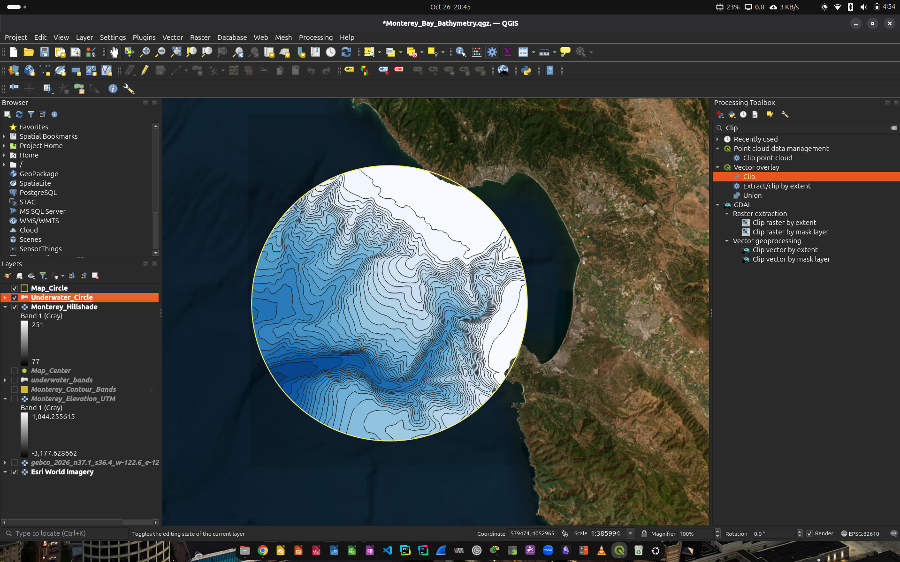

Circular clipping established in the blue map.

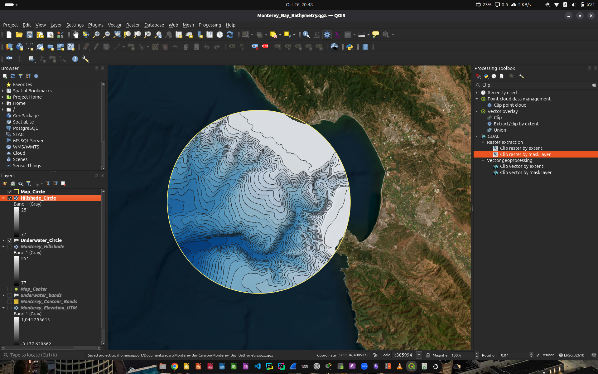

The circle and clipped layers before the magenta styling changes.

# 9 Set the magenta background and ramp

1. Open Project > Properties > General and set the project background color to #D00080. The background control may appear under a background or canvas section depending on QGIS version.

2. Turn off Esri World Imagery and any other basemap.

3. Open Underwater_Circle > Properties > Symbology. Keep Graduated and the value expression -"ELEV_MAX".

4. Use a continuous magenta to white ramp. Under Layer Rendering, set layer opacity to 100 percent, Layer blending mode to Normal, and Feature blending mode to Normal.

5. Click Apply. Inspect which depths receive each color. For shallow magenta and deep white, the lowest styling values must be magenta and the highest white. Use the color ramp menu > Invert Color Ramp if needed.

6. Verify a feature with Identify Features rather than judging depth only by its screen position. In the final session screenshot, the shallow shelf is white and deeper parts are magenta. Reversing that scheme is an optional design change, not a correction to the underlying data.

If a ramp edit does not recolor the existing classes, use its menu to reapply it or click Classify with the same class settings. Do not repeatedly rebuild breaks when only adjusting shadows.

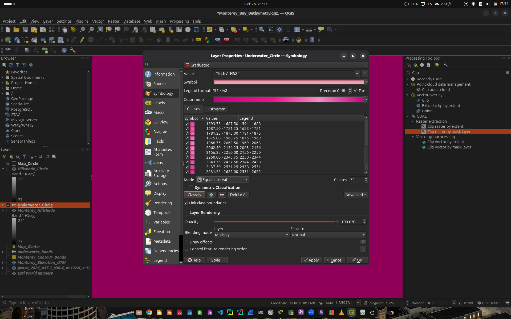

Problem state: Multiply applied to the whole layer suppressed the light colors. Use Normal here.

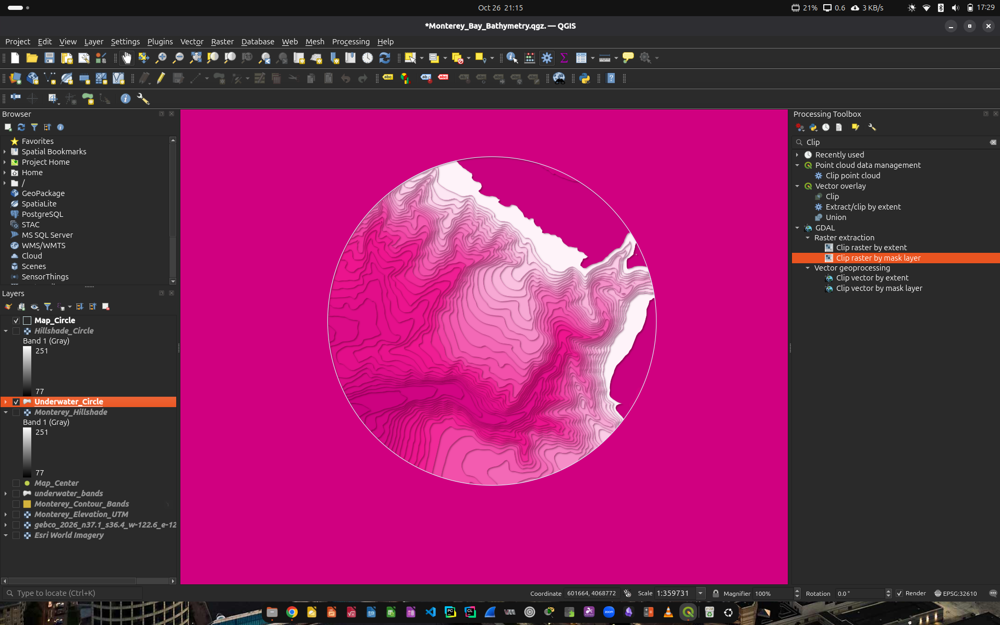

White became visible after correcting the layer blending and ramp.

# 10 Apply the final paper shadows

1. Open Underwater_Circle > Properties > Symbology. Click the long Symbol preview above the color ramp.

2. Select Simple Fill. Set Stroke style to No Pen.

3. Enable Draw effects and open the effect properties button beside it. Leave Source enabled so the polygon fill remains visible.

4. Enable Inner Shadow. Disable Drop Shadow, Inner Glow, and Outer Glow.

5. Select Inner Shadow and enter the final settings below. Confirm all distance units are millimetres.

Offset distance: 1.0 mm

Direction: 135 degrees

Blur radius: 0.4 mm

Opacity: 75 percent

Color: #30001F

Blend mode: Multiply

Draw mode: Render and modify

6. Click OK to close Effect Properties, OK to close Symbol Settings, then Apply in Layer Properties.

These settings were chosen visually for this map. They are not measured or recovered settings from the Arayat reference. Keep the whole layer blend mode Normal: Multiply belongs inside the shadow effect only.

If only one class changes, you edited an individual class swatch. Reopen the base Symbol preview above the class table and apply the effect to the renderer’s symbols. Inspect several light and dark bands after applying.

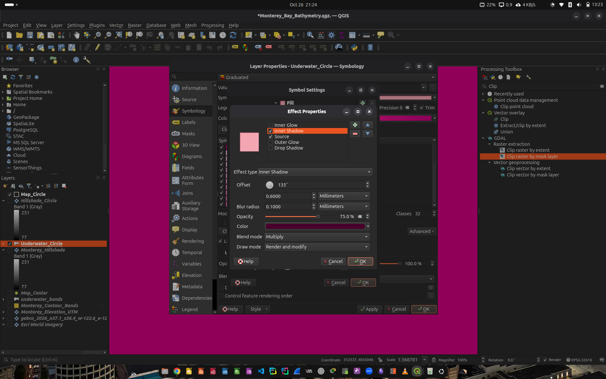

Effect Properties location. This is an intermediate inner shadow configuration, not the final values.

# 11 Understand the shadow experiments

The flat result after switching to Drop Shadow did not match the reference. Shadows extending beyond a polygon can be covered by other polygons as they render. Drawing order is a likely explanation for the session result, but it was not isolated with a controlled test. Inner Shadow kept the shading inside each band and was the effective choice here.

The 0.1 mm blur experiment removed softness but made edges look like contour strokes. Raising the offset to 1.0 mm made the shadow wider. A 0.4 mm blur and 75 percent opacity then softened the falloff while retaining contrast.

1. If the map looks blurry, reduce the shadow blur gradually. Do not change raster resolution to fix a graphic shadow problem.

2. If edges look like uniform outlines, confirm Stroke style is No Pen. Then check the enabled shadow effect and its offset.

3. If narrow bands become black, reduce offset before increasing blur. Try 0.7 mm and inspect at the intended export size.

4. If the shadow seems absent, check the effect checkbox, Source, the chosen effect name, units, layer visibility, and whether the base symbol or just one class was edited.

5. If colors darken everywhere, check the whole layer’s blending mode first. It must be Normal.

The mountain and canyon have different geometry. A branching canyon cannot produce the same central peak pattern simply by copying colors and shadow settings.

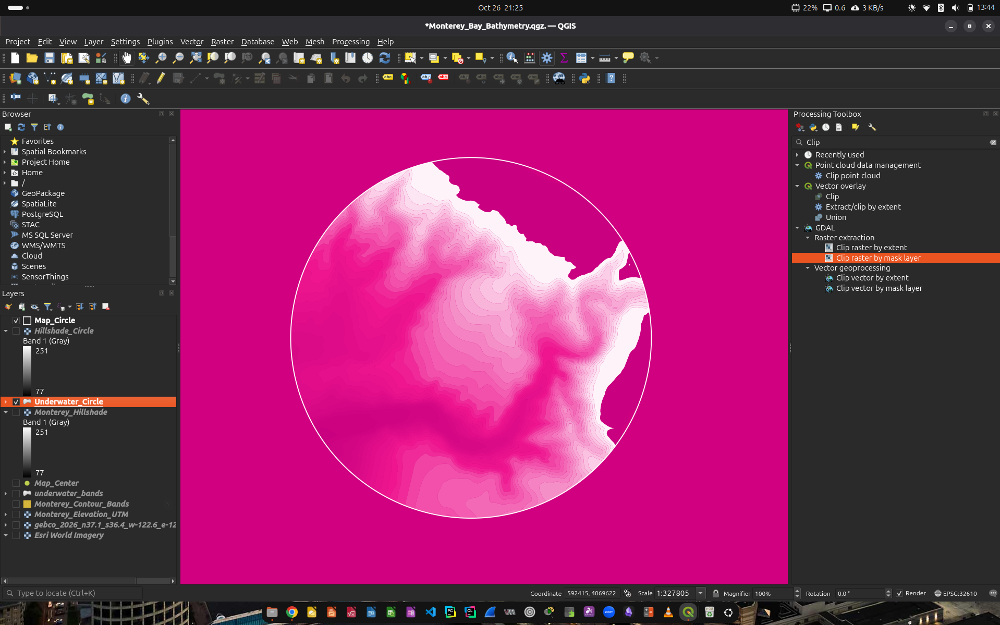

Drop shadow experiment with little visible relief.

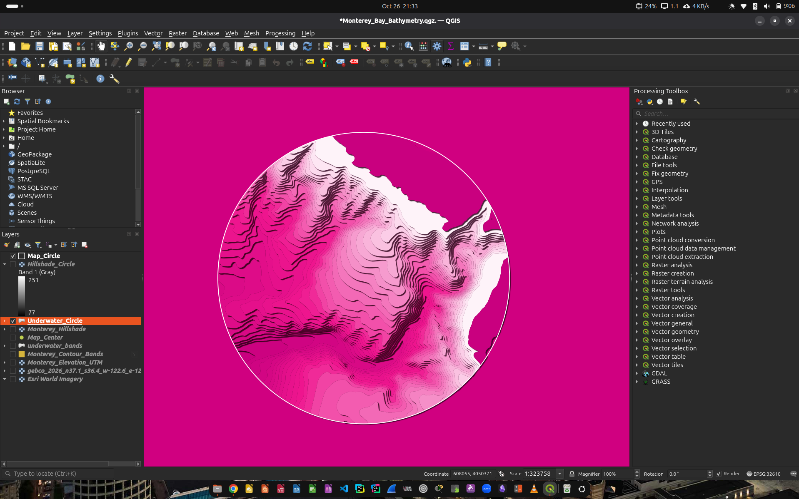

Stronger but harsher shadows before the final blur adjustment.

# 12 Create and export a poster

These are recommended finishing steps. The uploaded screenshots show the QGIS canvas, not a completed exported print layout.

1. Save the project. Choose Project > New Print Layout and name it Monterey Canyon Poster.

2. Right click the page > Page Properties. Set a custom portrait page, for example 200 by 250 mm.

3. Set the page background to the same magenta as the canvas. Add a map item, leaving room above it for a title. Turn off its frame and use a matching background if needed.

4. Use Move Item Content to position the entire circle inside the map item. Adjust its scale until the circle fits with comfortable margins.

5. Add a label: MONTEREY CANYON. Use bold white text, centered above the map. Add a small source credit such as Bathymetry GEBCO 2026 • Map Teo Espero.

6. Lock the map’s layers and styles once the composition is ready. Keep Map_Circle and Underwater_Circle visible; hillshade and basemap off.

7. Set layout export resolution to 300 dpi and use Layout > Export as Image for PNG. PDF is also available. Effects may cause rasterization; inspect the exported result rather than relying on the canvas alone.

8. Open the exported file and check the circle edge, text, shadow thickness, and color contrast at full size. Shadow distances use physical units, so assess the appearance at the final layout scale.

9. Save the .qgz again so the print layout and layer styling remain part of the project.

# 13 Checks and troubleshooting

Before exporting, confirm the elevation raster is EPSG:32610 and underwater values remain negative. Confirm the contour interval is 100 metres, the styling expression is -"ELEV_MAX", and the clip overlay is Map_Circle.

Wrong file downloaded: If the raster contains codes instead of elevations, it may be the TID grid. Download the numeric elevation GeoTIFF.

Unexpected map location: Verify the source CRS and west and east bounds. Assigning UTM directly to longitude and latitude does not reproject them; use Warp.

Unexpected buffer size: Use the projected point layer in EPSG:32610 and enter 30000 metres, not degrees. A 30000 metre buffer is a radius, not a diameter.

Raster outside the circle: Clip the raster separately by mask, or turn it off. Vector clipping does not clip raster layers.

Light bands disappear: Whole layer Multiply blends white into the magenta beneath it. Set Layer Rendering > Layer blending mode to Normal.

Ramp gets lighter and then darker again: Remove unwanted intermediate stops and use two distinct endpoints. Invert only when the desired depth direction is reversed.

Dark line around every edge: Check for a remaining stroke in Simple Fill or an additional symbol layer. No Pen removes ordinary outlines; it does not disable inner shadows.

Effect settings appear correct but map does not update: Check that Underwater_Circle is the visible layer and click Apply. Inspect the base symbol and multiple class symbols.

Broken layer after moving folders: Repair the datasource path in QGIS, then save the project. Keep data and outputs together when sharing the .qgz.

Apparent low terrain detail: The 400 metre reprojection is a regional rendering choice. More color classes or finer output pixels do not create new bathymetric measurements.

# 14 Sources and project limitations

Tutorial inspiration credited by Teo Espero to Ariel Dome

https://www.youtube.com/live/VQ6Ee2jETuo

GEBCO data download application

https://download.gebco.net/

GEBCO gridded bathymetry data and release information

https://www.gebco.net/data-products/gridded-bathymetry-data

GEBCO 2026 grid description

https://www.gebco.net/data-products-gridded-bathymetry-data/gebco2026-grid

QGIS raster extraction documentation including Contour Polygons

https://doc.qgis.org/3.44/en/docs/user_manual/processing_algs/gdal/rasterextraction.html

QGIS vector properties and draw effects documentation

https://docs.qgis.org/testing/en/docs/user_manual/working_with_vector/vector_properties.html

The GEBCO numeric grid and QGIS effect descriptions were checked against primary documentation when preparing this guide. The specific styling values and working rectangle come from the project session. Screenshots are user supplied; the Arayat image is included as a visual reference, not presented as Teo’s map.

This guide reconstructs the workflow from the conversation and screenshots. The .qgz, rasters, and GeoPackages were not supplied for inspection. Exact center coordinates, final class ranges, saved effect propagation across every feature, and export appearance could not be audited directly. Identify checks and export review are therefore included in the instructions.

The circular crop omits portions of Monterey Bay. This artwork is not a navigation chart or a complete survey of Monterey Canyon.

# Session screenshot appendix 1

These screenshots preserve intermediate stages. Use the numbered workflow and final settings rather than treating every visible dialog value as a final instruction.

Arayat visual reference supplied by the user

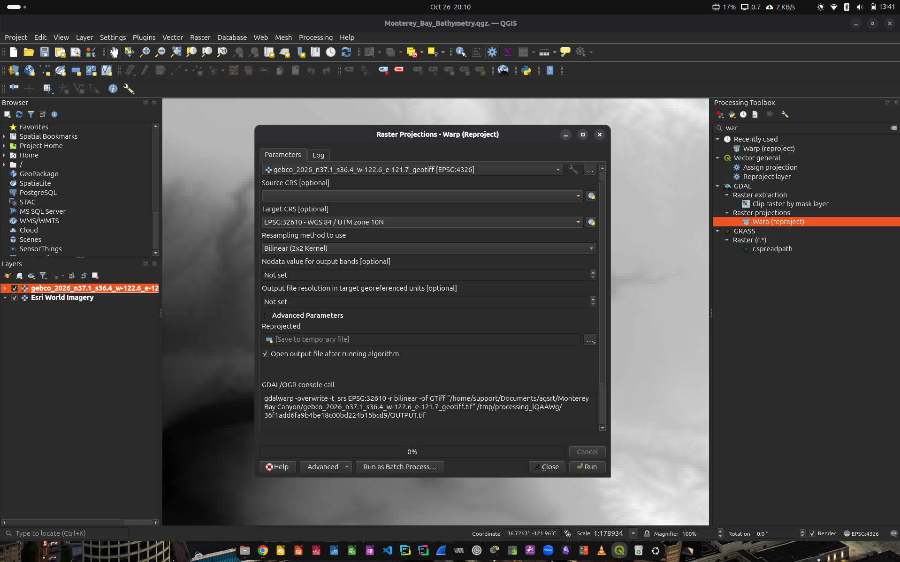

Reprojection settings and output options

# Session screenshot appendix 2

These screenshots preserve intermediate stages. Use the numbered workflow and final settings rather than treating every visible dialog value as a final instruction.

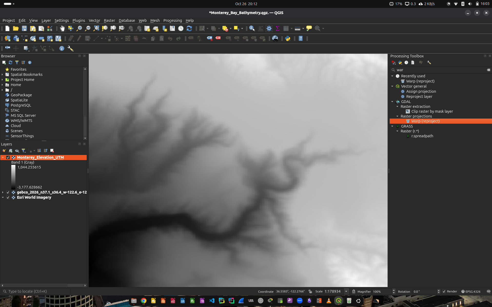

Projected terrain raster

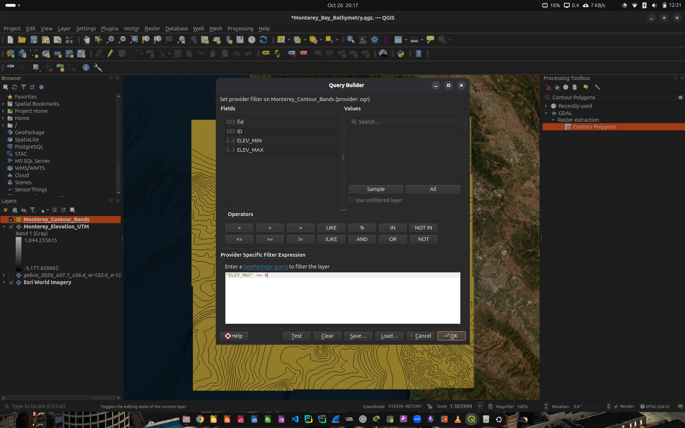

Underwater polygon filtering and export preparation

# Session screenshot appendix 3

These screenshots preserve intermediate stages. Use the numbered workflow and final settings rather than treating every visible dialog value as a final instruction.

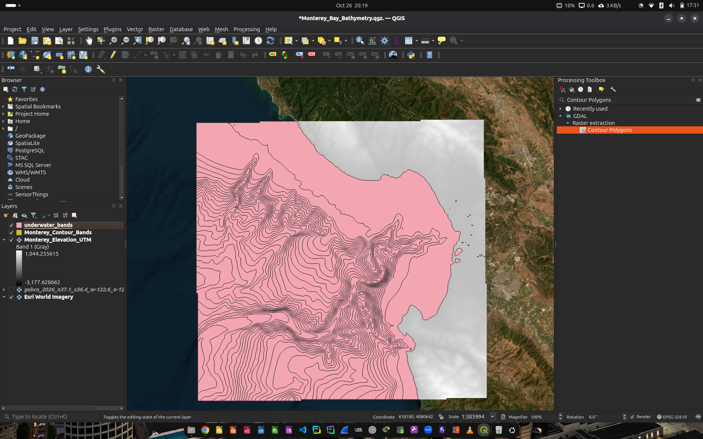

Initial polygon styling

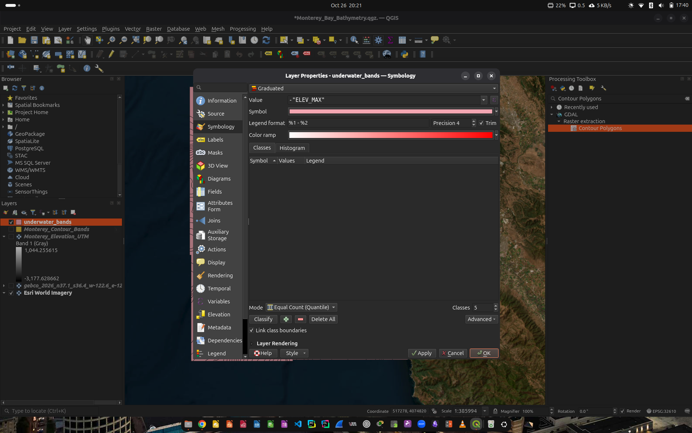

Early color ramp selection

# Session screenshot appendix 4

These screenshots preserve intermediate stages. Use the numbered workflow and final settings rather than treating every visible dialog value as a final instruction.

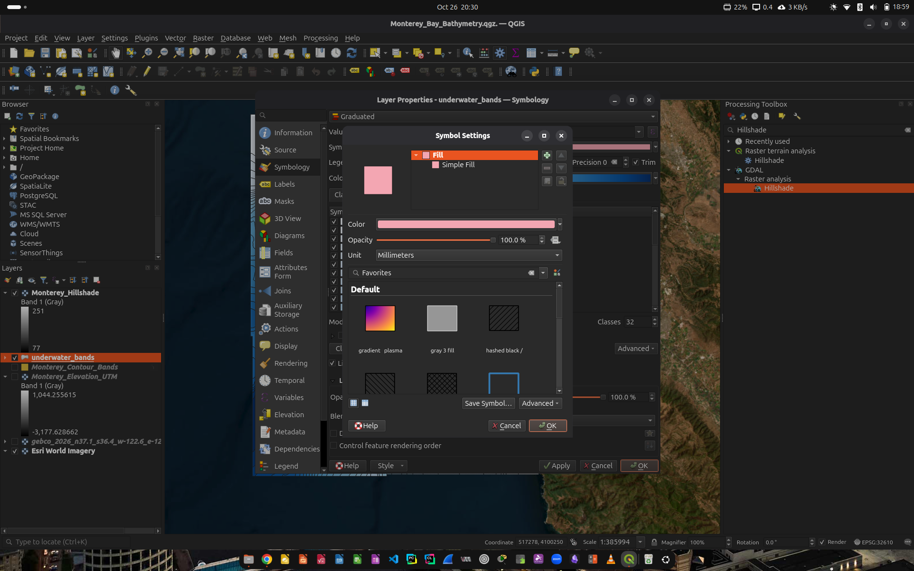

Symbol styling controls

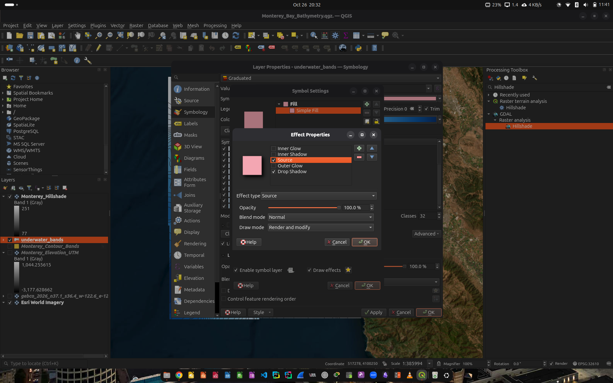

Draw effects controls during early testing

# Session screenshot appendix 5

These screenshots preserve intermediate stages. Use the numbered workflow and final settings rather than treating every visible dialog value as a final instruction.

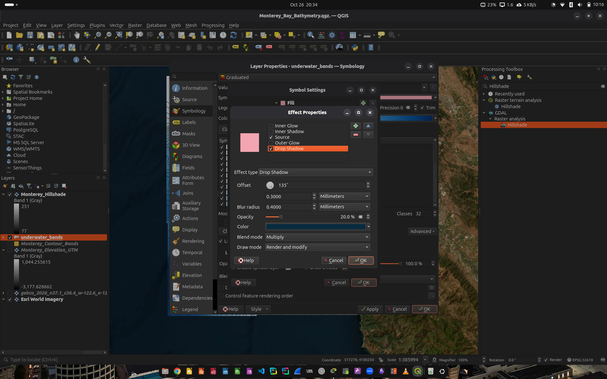

Early shadow settings

Blue map after symbol effects

# Session screenshot appendix 6

These screenshots preserve intermediate stages. Use the numbered workflow and final settings rather than treating every visible dialog value as a final instruction.

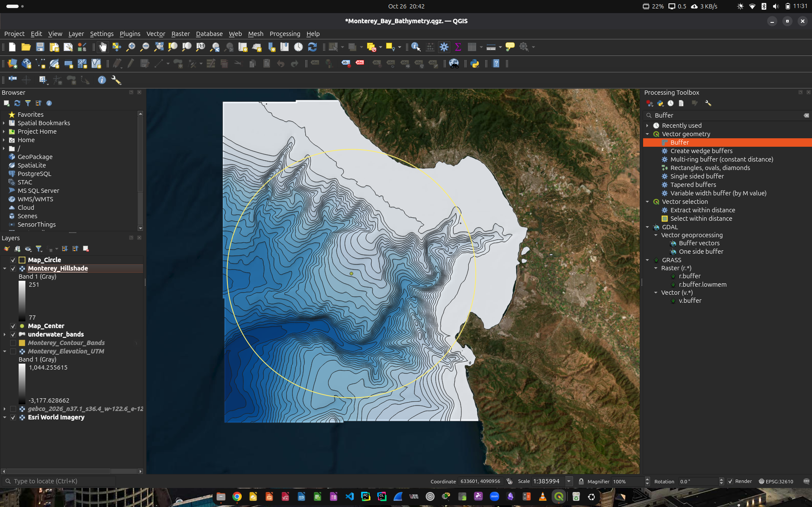

Map before the circle clip

Repeated Arayat visual reference

# Session screenshot appendix 7

These screenshots preserve intermediate stages. Use the numbered workflow and final settings rather than treating every visible dialog value as a final instruction.

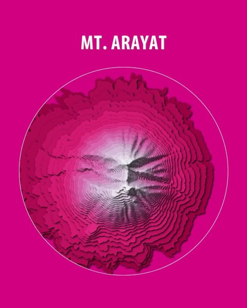

Repeated Arayat visual reference

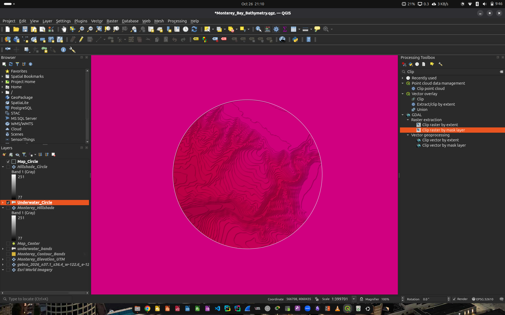

Muted magenta result before blend correction

# Session screenshot appendix 8

These screenshots preserve intermediate stages. Use the numbered workflow and final settings rather than treating every visible dialog value as a final instruction.

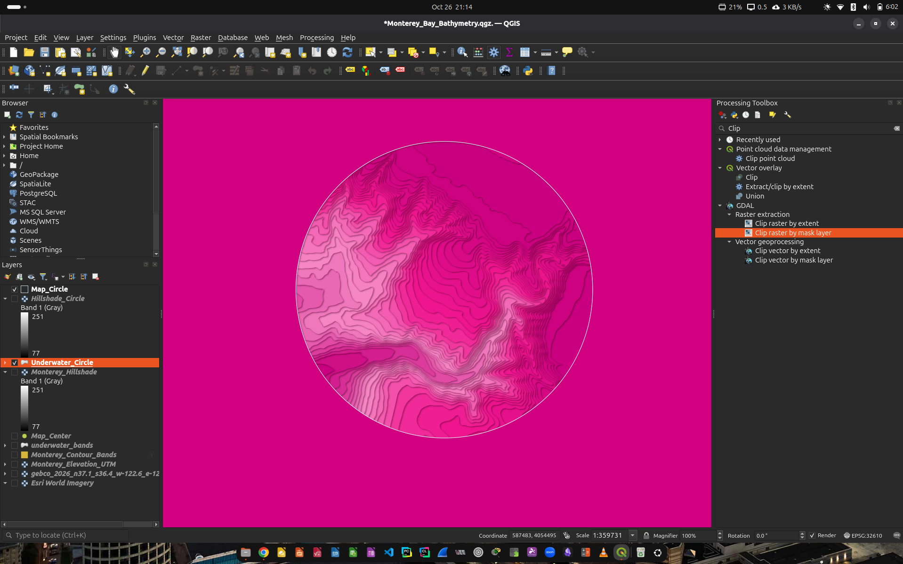

Light colors returning after blend correction

Arayat reference used for shadow comparison

# Session screenshot appendix 9

These screenshots preserve intermediate stages. Use the numbered workflow and final settings rather than treating every visible dialog value as a final instruction.

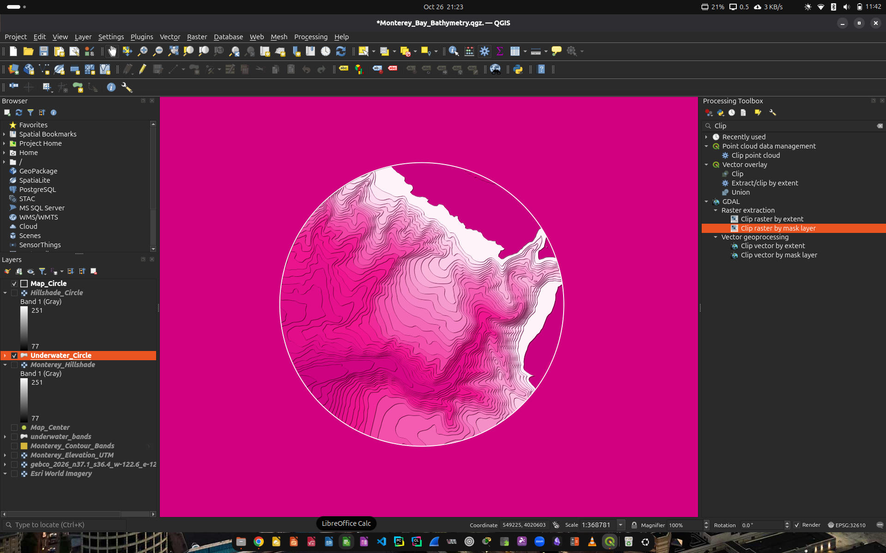

Sharp contour edges before final shadow tuning

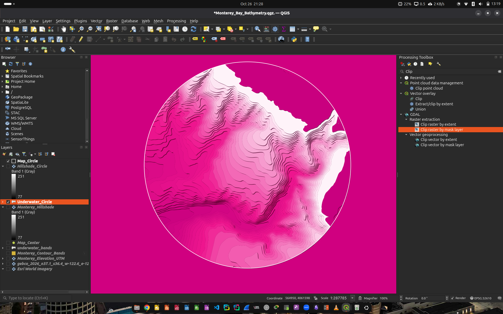

Directional inner shadows with stronger edges

# Session screenshot appendix 10

These screenshots preserve intermediate stages. Use the numbered workflow and final settings rather than treating every visible dialog value as a final instruction.

Reduced shadow strength before the final offset change
